

  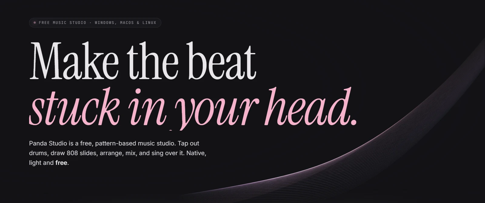

  
  
  
  
  

  <b>Panda Studio is a free, pattern-based music studio for Windows, macOS and Linux.</b> 
  Tap out drums, draw 808 slides, arrange, mix, and sing over it. 
  Native, light (a 6&nbsp;MB installer on Windows) and free.

  <a href="https://github.com/thePanda-X/panda-studio-releases/releases/latest"><b>⬇&nbsp; Download the latest version</b></a>
  &nbsp;·&nbsp;
  <a href="#a-quick-tour">Take the tour</a>
  &nbsp;·&nbsp;
  <a href="#questions">Questions</a>

 

  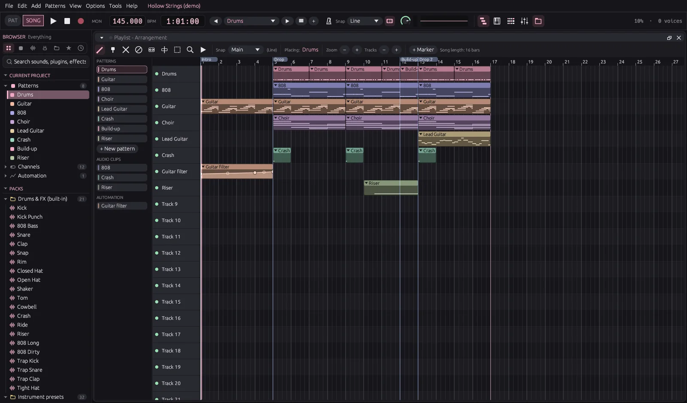
   <i>Hollow Strings</i>, the dark guitar trap beat that opens with the studio.

---

## Get started in a minute

Grab the file for your system from the **[latest release](https://github.com/thePanda-X/panda-studio-releases/releases/latest)**, install it, then **press Space**: the studio opens with a demo song loaded, ready to play, take apart and remix.

| | Download | Install | Needs |
|---|---|---|---|
| **Windows** | `PandaStudio-Setup-<version>.exe` | Run it. It installs just for you (no admin rights needed) and adds Start menu and desktop shortcuts. | Windows 10 or 11, 64-bit |
| **macOS**  experimental | `PandaStudio-<version>-macos.dmg` | Open it and drag Panda Studio into Applications. The first time, right-click it and choose **Open** ([more](#macos-says-panda-studio-cant-be-opened)). | macOS 11 or newer, Apple silicon or Intel |
| **Linux**  experimental | `PandaStudio-<version>-linux-x86_64.AppImage` | Make it executable (`chmod +x`) and open it. One file, no install. | x86-64, a desktop with ALSA, PipeWire or PulseAudio |

Panda Studio checks for updates once a day and installs them for you when you say so, on all three systems.

> [!NOTE]
> Panda Studio is made and tested on **Windows**. The **macOS** and **Linux** versions are **experimental**: the same studio with the same features, but expect some rough edges.

---

## A quick tour

Every part of the studio is a window you can float, dock, maximise or close. **F6**, **F7**, **F5** and **F9** open the four you'll use most.

<table>
  <tr>
    <td width="50%" valign="top">
      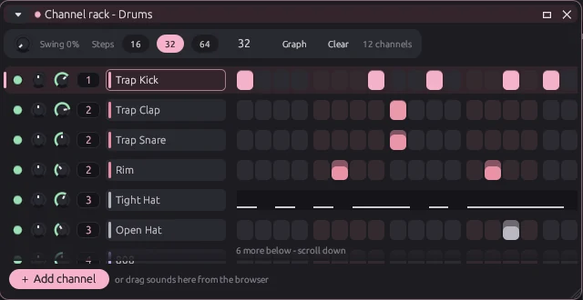
      <h3>Channel rack <kbd>F6</kbd></h3>
      Sketch the groove in the step sequencer: 16, 32 or 64 steps, swing, and 21 built-in drums including a trap kit. Mute, solo, pan and route each channel, and shape velocity and panning per step in the graph editor.
    </td>
    <td width="50%" valign="top">
      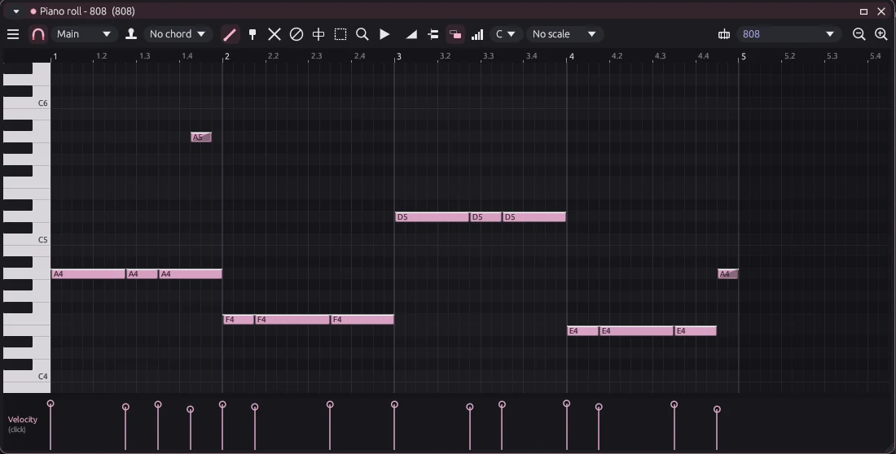
      <h3>Piano roll <kbd>F7</kbd></h3>
      Draw, paint, slice and strum notes. Use chord stamps and scale highlighting, and draw <b>slide notes</b> that bend a long 808 into the next pitch, with mono and portamento per channel.
    </td>
  </tr>
  <tr>
    <td width="50%" valign="top">
      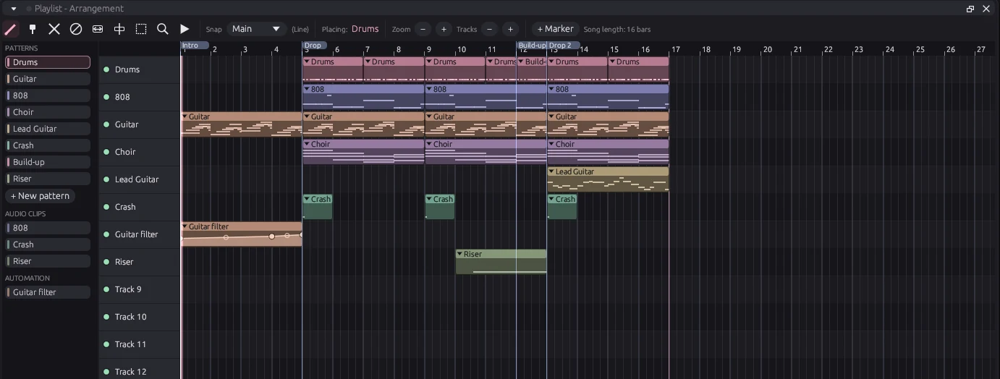
      <h3>Playlist <kbd>F5</kbd></h3>
      Arrange pattern clips, audio clips and automation clips on tracks. Drop audio from your file manager right onto the bar you want, and right-drag the ruler to loop a region.
    </td>
    <td width="50%" valign="top">
      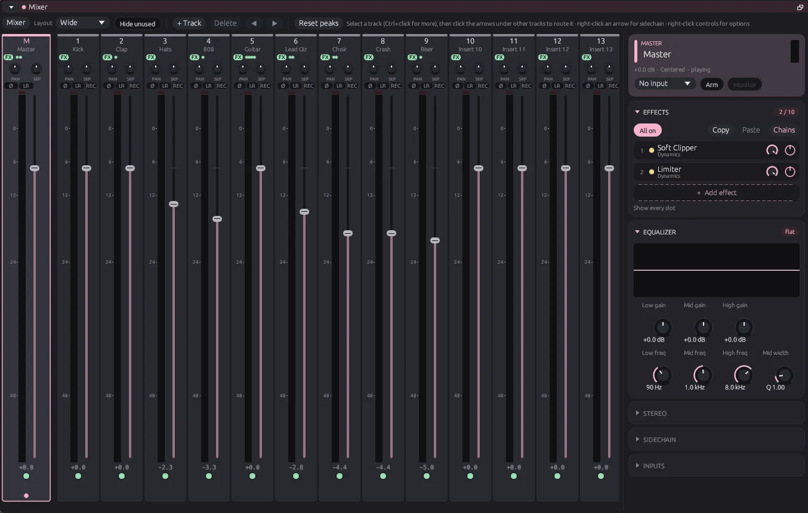
      <h3>Mixer <kbd>F9</kbd></h3>
      Up to 125 inserts with ten effect slots each, sends, sidechain routing and a built-in 3-band EQ. Each strip has peak meters with hold and a clip light.
    </td>
  </tr>
</table>

---

## 37 effects. Nine instruments. Your plugins too.

<table>
  <tr>
    <td width="50%" valign="top">
      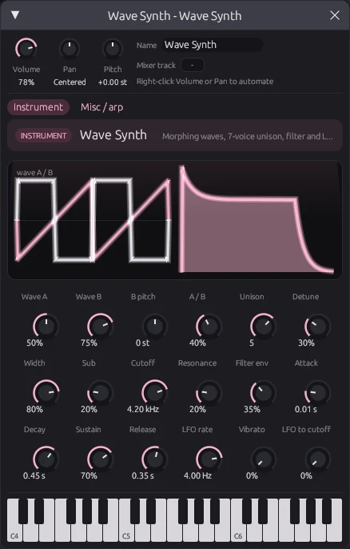
    </td>
    <td width="50%" valign="top">
      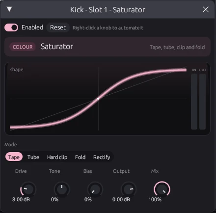
    </td>
  </tr>
</table>

**Instruments:** Sampler, Tri-Osc Synth, String Pluck, FM Tone, 808 Bass, Wave Synth, Electric Keys, Mallets and Vox Choir, plus 32 instrument presets to start from.

**Effects**, grouped the way the studio's browser shows them:

| | |
|---|---|
| **Vocal** | De-esser · Vocal Compressor · Pitch Tune · Doubler · Exciter · Plate Reverb · Recorder |
| **Dynamics** | Compressor · Glue Compressor · Limiter · Noise Gate · Transient Processor · Multiband Maximizer · Soft Clipper · Pump |
| **EQ & filter** | 3-Band EQ · Parametric EQ · Filter |
| **Space** | Room Reverb · Hall Reverb · Echo Delay · Tape Echo |
| **Colour** | Drive · Saturator · Bitcrusher |
| **Modulation** | Chorus · Phaser · Flanger · Auto Pan · Stereo Tool |
| **Sound design** | Frequency Shifter · Ring Mod · Resonator · Trance Gate · Tape Stop · Grain Cloud · Half Time |

**Your plugins:** Panda Studio hosts **VST3 and VST2** instruments and effects in their real interfaces. Their settings are saved inside the project, and any of them can take a sidechain from another mixer track. (On macOS and Linux, VST2 plugins show simple sliders instead of their own window.) Bring your own samples too: WAV, MP3, FLAC, OGG, AIFF or M4A.

---

## Then you sing

Record a vocal, tune it note by note, and harmonise it, without leaving the studio.

  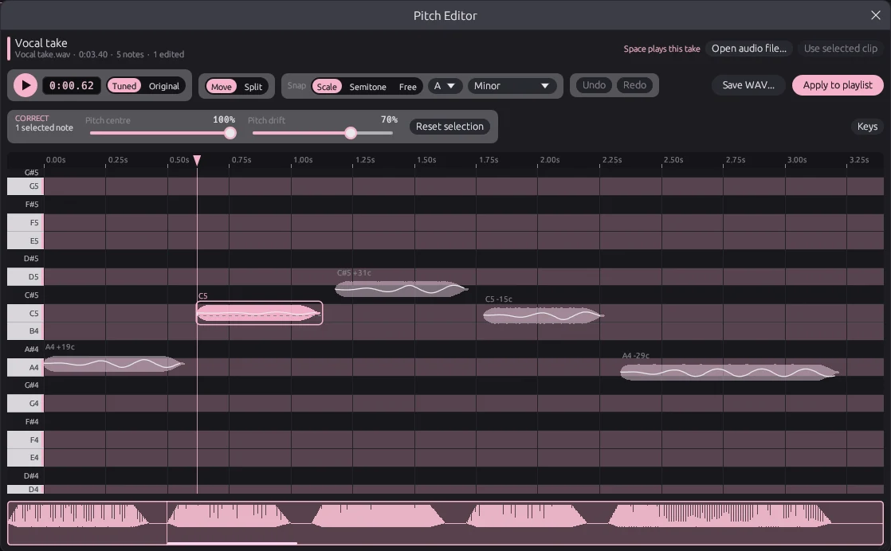

**Pitch Editor.** Your take appears as notes. Drag them onto the key, then dial in *centre* and *drift* to set how much gets corrected. The voice keeps its own character, with no chipmunk effect.

<table>
  <tr>
    <td width="50%" valign="top">
      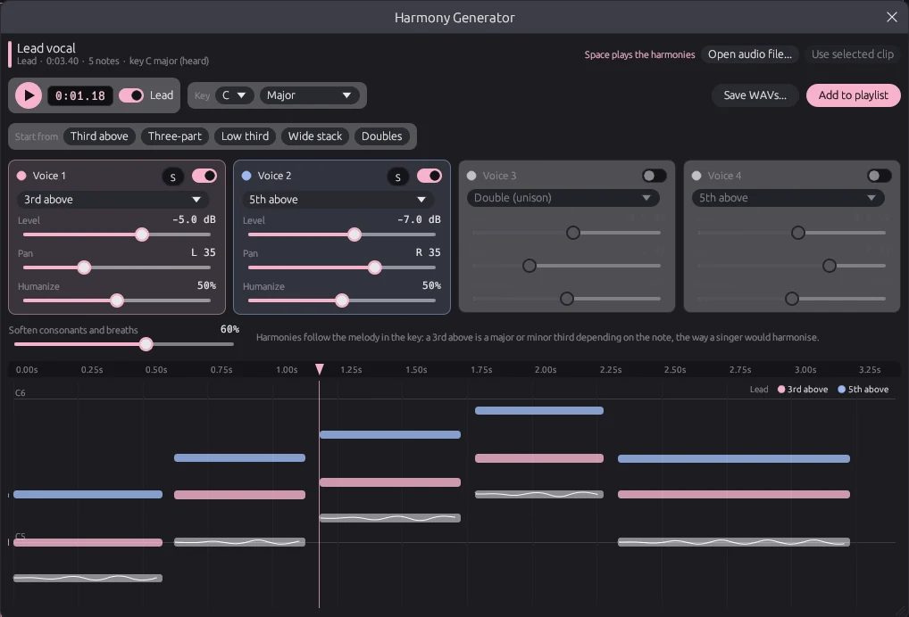
      <b>Harmony Generator.</b> A third above, a fifth above, a low third, or doubles. The harmonies follow your key the way a singer would.
    </td>
    <td width="50%" valign="top">
      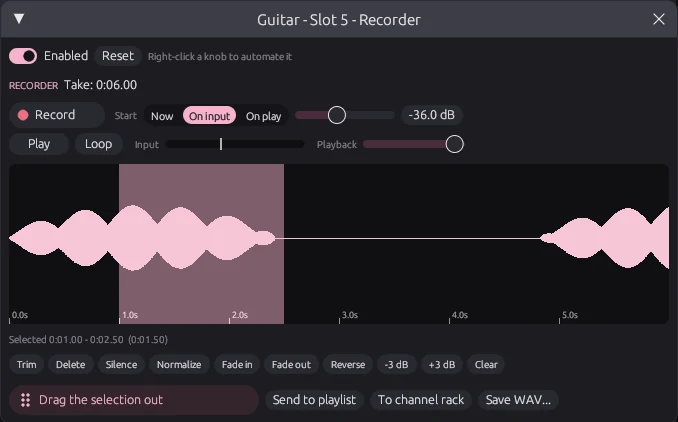
      <b>Recorder.</b> It starts recording when you sing. Trim the take, then drag it straight onto the playlist.
    </td>
  </tr>
</table>

---

## Pick a mood

  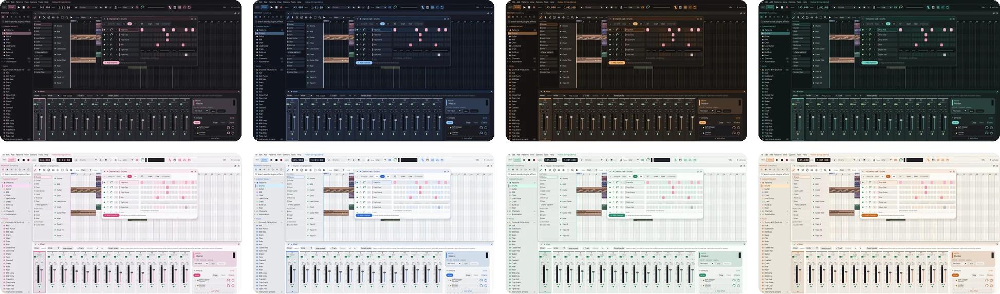

  <b>Dark:</b> Panda Pink · Midnight · Ember · Lagoon &nbsp;&nbsp;|&nbsp;&nbsp; <b>Light:</b> Blossom · Paper · Sage · Sand 
  Options › Theme. The studio remembers your choice.

---

## The details

|  |  |
|---|---|
| **Native and light** | Written in pure Rust, with no browser engine inside: a 6 MB installer on Windows. |
| **Three demo songs** | *Hollow Strings* (dark guitar trap, 145 BPM), *Midnight Trap* (808 slides and hi-hat rolls, 140 BPM) and *Night Drive* (124 BPM), under File › Demos. |
| **Play it live** | MIDI keyboards, or your computer keyboard as a piano. Record straight into a pattern. |
| **Record audio** | Arm a mixer track, pick its input and record vocals or guitar straight into the playlist, with an optional count-in. |
| **Automation** | Right-click almost any knob to automate it, then shape the curve in the automation editor. |
| **Export** | WAV in 16, 24 or 32-bit float at up to 96 kHz: the song, a pattern or a loop region, with optional stems per mixer track. |
| **Never lose a song** | Automatic backup every 2 minutes, safe saving, and damaged projects repaired when they open. |
| **Three systems** | Windows, plus experimental macOS (Apple silicon and Intel) and Linux builds. Projects are the same `.panda` files everywhere. |
| **Updates** | Checked once a day on every system. Each update is signed and verified before it installs. |

---

## Questions

<b>Is it really free?</b>

 
Yes. No trial, no account, no features held back. Download it and make music.

<b>Why are macOS and Linux "experimental"?</b>

 
Panda Studio is made and tested day to day on Windows. The macOS and Linux versions are built from the same code with the same features, and they update themselves the same way, but they get less testing, so you're more likely to meet a rough edge there. VST2 plugins also show simple sliders instead of their own window on those systems (VST3 plugins open normally).

<b>Windows warned me about the installer. Is it safe?</b>

 
The installer isn't code-signed with a paid certificate yet, so Windows SmartScreen may show "Windows protected your PC" the first time. Choose <b>More info › Run anyway</b>. Download it only from this repository's <a href="https://github.com/thePanda-X/panda-studio-releases/releases">Releases</a> page. Updates that the studio installs itself are signed and checked (size and SHA-256) before anything runs.

<b>macOS says Panda Studio can't be opened.</b>

 
The Mac app isn't notarised by Apple yet, so macOS asks you to confirm the first time. Right-click (or Control-click) Panda Studio in Applications and choose <b>Open</b>, then <b>Open</b> again. On macOS 15 and newer, if that doesn't offer Open, try to open it once, then go to <b>System Settings › Privacy &amp; Security</b> and click <b>Open Anyway</b>. You only need to do this once: updates install without asking.

<b>The Linux AppImage doesn't start.</b>

 
Make sure it's executable: <code>chmod +x PandaStudio-*.AppImage</code> (or tick "Allow executing file as program" in its properties). AppImages also need FUSE, which most desktop distributions include; if yours doesn't, see the <a href="https://docs.appimage.org/user-guide/troubleshooting/fuse.html">AppImage FUSE guide</a>. The Linux build is for x86-64 computers.

<b>Can I open projects from other music software?</b>

 
Panda Studio saves its own <code>.panda</code> projects. You can bring in audio from anywhere (WAV, MP3, FLAC, OGG, AIFF, M4A), use your VST3 and VST2 plugins, and export WAV files and stems to take your music elsewhere.

<b>How do I uninstall it?</b>

 
<b>Windows:</b> Settings › Apps › Installed apps › Panda Studio › Uninstall. 
<b>macOS:</b> drag Panda Studio from Applications to the Trash. 
<b>Linux:</b> delete the AppImage file. 
Your projects stay where you saved them.

<b>Where is the source code?</b>

 
Panda Studio itself is closed source. This repository holds its releases (the installers and the update manifest) and the source of its website.

